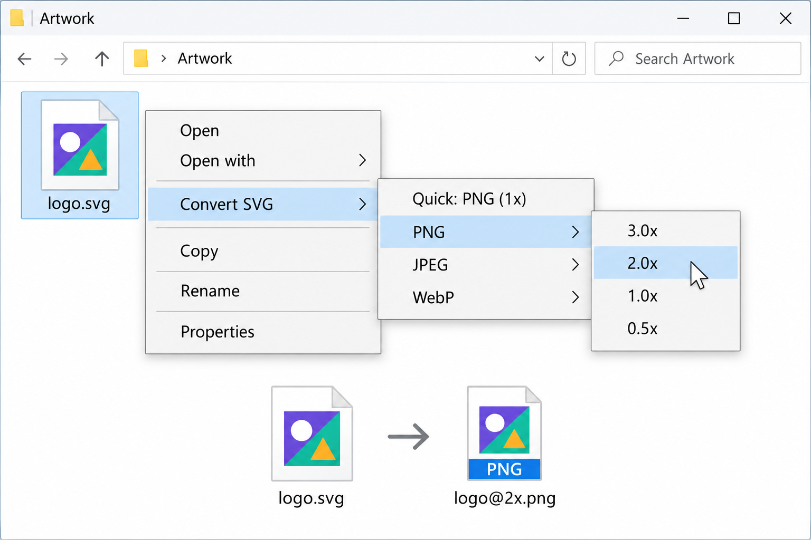

# SVG Converter

Convert SVG files to **PNG, JPEG, or WebP** directly from the Windows right-click menu.
Choose a format and size, and the image is saved beside your original SVG.

**[Download the latest release](https://github.com/alizreik-au/svg-to-image-converter/releases/latest)** · [Installation guide](INSTALL.md) · [Report an issue](https://github.com/alizreik-au/svg-to-image-converter/issues)



*Generated illustration of the Windows classic context menu; appearance may vary.*

## Install

Requires **Windows 10 (1809+) or Windows 11, 64-bit**.

1. Download `SvgConverter-<version>-windows-x64-setup.exe` from the [latest release](https://github.com/alizreik-au/svg-to-image-converter/releases/latest).
2. Run the installer. No administrator access or extra runtimes are needed.
3. Right-click an `.svg` file and choose **Convert SVG**.

On **Windows 11**, select **Show more options** first.
The installer is unsigned, so Windows may show a SmartScreen or unknown-publisher warning.

To uninstall, open **Settings → Apps → SVG Converter → Uninstall**.

## Use it

- **Quick: PNG (1x)** creates a PNG at the SVG's original size.
- Choose **PNG**, **JPEG**, or **WebP**, then **0.5x, 1x, 2x, or 3x**.
- Images are saved in the same folder: `logo.svg` → `logo.png` at 1x, or `logo@2x.png` at 2x.
- Your original SVG is kept, and existing output files are protected from accidental overwriting.

PNG and WebP preserve transparency. JPEG uses a white background by default.

## Build from source

Requires the **Rust MSVC toolchain** and **Visual Studio C++ build tools** on Windows.

```powershell
cargo build --release --locked
cargo test --workspace --locked

# Optional command-line conversion
.\target\release\svg-converter.exe convert logo.svg -f png -s 2.0
```

To build the release installer, install [Inno Setup 6.3+ or 7](https://jrsoftware.org/isdl.php) and run:

```powershell
.\scripts\build-setup.ps1
```

The setup EXE and SHA-256 checksum are written to `target\installer`.
See [INSTALL.md](INSTALL.md) for advanced installation and MSIX options.

[MIT License](LICENSE)
